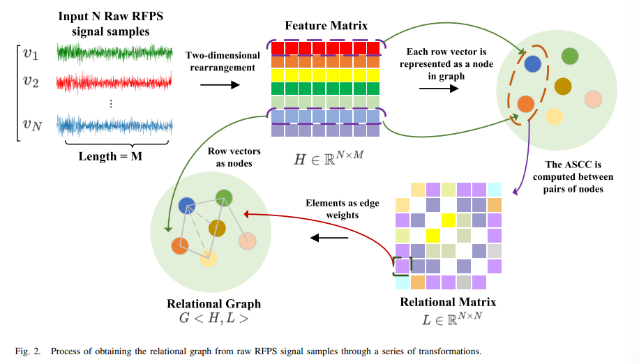
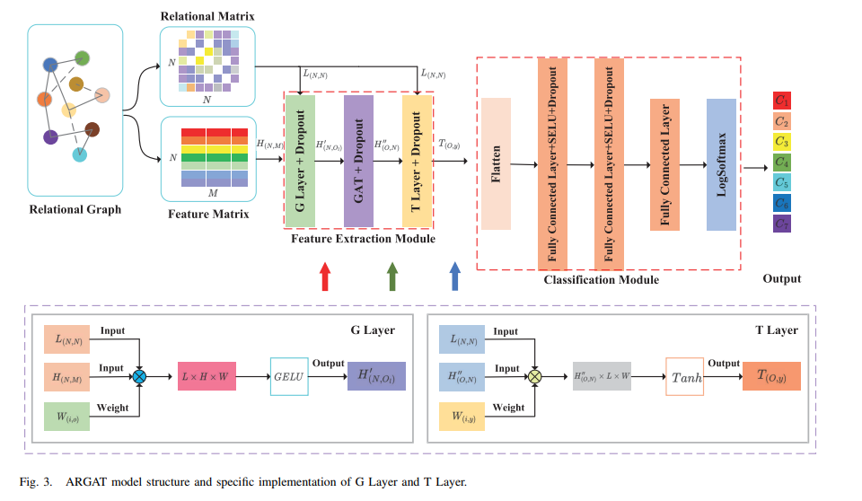
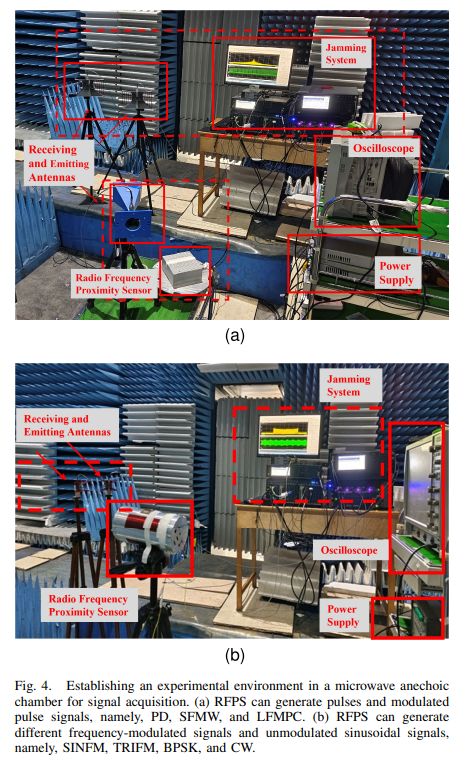
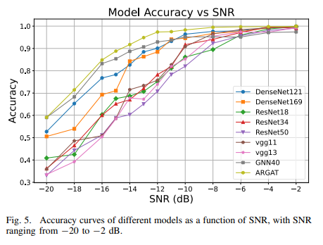
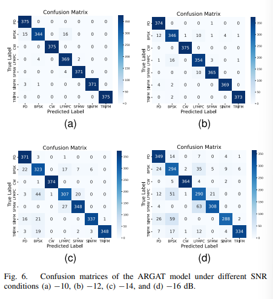
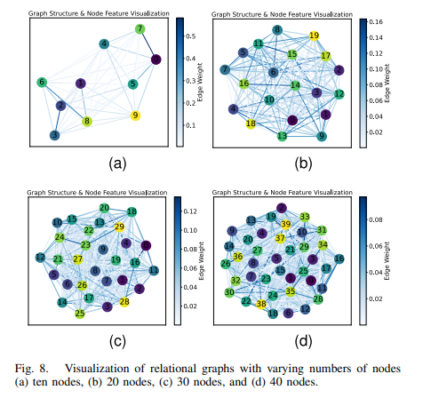

# [Modulation Identification] New Breakthrough in Radio Frequency Signal Recognition at Low Signal-to-Noise Ratio! ARGAT Model Accuracy Exceeds 91% [Attached with Python Code]

Automatic Modulation Recognition Based on Adaptive Relationship Graph Attention Network (Only Model Code Needed, Data Set Import and Training Code to Be Written by Oneself)

Title: Automatic Modulation Recognition Based on Adaptive Relationship Graph Attention Network
Abstract: Automatic modulation recognition plays a crucial role in signal reconnaissance. However, the signals from radio frequency proximity sensors are characterized by high frequencies, low power, and significant propagation loss, making accurate automatic modulation recognition under low signal-to-noise ratio a significant challenge. To address this, this paper proposes an Adaptive Relationship Graph Attention Network (ARGAT) suitable for low signal-to-noise ratio scenarios. In the preprocessing stage, the time-series data of multiple raw signals is reconstructed into a two-dimensional feature matrix, retaining the temporal continuity and local correlation of the signals; meanwhile, an Acceleration Covariance Clustering (ASCC) is introduced to robustly capture signal correlation under noise and outlier presence. The ARGAT framework integrates improved graph convolution, graph attention, and transposed graph convolution layers, capable of simultaneously extracting both the local structural information of the signal and its global feature correlation. Experimental results show that the model achieves over 91% classification accuracy at a signal-to-noise ratio of -14 dB, significantly outperforming mainstream models such as ResNet and DenseNet; ASCC also demonstrates superior performance compared to Pearson's Correlation Coefficient (PCC) across the full signal-to-noise ratio test range, especially evident in extremely low signal-to-noise ratio environments.
Introduction: The working principle of Radio Frequency Proximity Sensors (RFPS) is similar to radar, primarily used for target detection and providing control information. Due to their efficient and cost-effective characteristics, they are widely applied in civilian and military fields for short-range target detection, with precise recognition of their signals directly impacting target detection accuracy and system stability. Automatic Modulation Recognition (AMR) is a key technology for identifying the modulation type of received signals, playing a prominent role in electronic warfare and cognitive radio systems. However, RFPS operate mainly in K-band and higher millimeter wave bands, with low emission power and significant propagation loss due to high frequencies. This makes reconnaissance terminals prone to operating in low signal-to-noise ratio conditions, further exacerbating the challenges of automatic modulation recognition in adverse environmental conditions.
Traditional automatic modulation recognition methods mainly fall into two categories: maximum likelihood ratio based on hypothesis testing and feature extraction based on expert knowledge. The former relies on prior information, has high computational complexity, while the latter requires manual design of features and is difficult to determine thresholds in dynamic environments, with classification performance significantly deteriorating at low signal-to-noise ratios. Deep learning-based methods can automatically extract features, reducing the reliance on manual design, demonstrating superior performance under low signal-to-noise ratios and have become a research hotspot. Existing methods mostly utilize convolutional neural networks for feature extraction, but they face issues such as the need for additional layers to learn global features, complex models, and susceptibility to overfitting.
Graph Neural Networks (GNN) outperform Convolutional Neural Networks in capturing both local and global feature relationships. In recent years, they have been applied to automatic modulation recognition. However, existing methods that convert time-series signals into graph structures disrupt the signal's temporal sequence, continuity, and local correlation. At low signal-to-noise ratios, noise can also interfere with the definition of edges and nodes in the graph, affecting feature extraction results. To address these issues, this paper proposes an automodulation recognition method for radio frequency near-field sensor signals based on ARGAT, detailing three core innovations. The article also introduces its overall structure.
Method Introduction: This paper proposes the ARGAT model to automatically modulate and identify signals from radio frequency proximity sensors. The overall process includes two core parts: dataset preprocessing and the design of the ARGAT model. It focuses on seven common types of radio frequency proximity sensor modulation signals (continuous wave, triangular linear frequency modulation, sinusoidal frequency modulation, pulse, linear frequency modulation pulse compression, binary phase-shift keying, and stepped frequency modulation). Noise is added following the additive Gaussian white noise channel model.
1. The core of data preprocessing is to construct the raw time series signal into a relational graph, which includes feature matrix and relation matrix:
★  
Feature Matrix Construction: For the same signal-to-noise ratio and different parameter settings, a group of signals from the same type of radio frequency near-field sensors are collected. Each group corresponds to a node in the graph, forming an N×M-dimensional feature matrix with retained time correlation for each signal.
★  
Relationship Matrix Construction: Proposes the Acceleration of Co-relatedness Coefficient (ASCC) to calculate the correlation between signals. It first computes a normalized mutual correlation matrix through Fast Fourier Transform (FFT), then uses Randomized Principal Component Analysis (RPCA) to reduce the dimensionality of the feature matrix, and finally calculates the Pearson Correlation Coefficient (PCC) matrix. The adjacent matrix is obtained by multiplying elements-wise from both matrices and taking the absolute value. After normalization, the resulting relationship matrix realizes adaptive weight allocation among graph node pairs, exhibiting noise resistance and the ability to capture time offsets and linear correlations.
2. The ARGAT model design consists of a feature extraction module and a classification module, with a total parameter count of 1281943, balancing complexity and training efficiency.
★  
Feature Extraction Module: Integrates an improved graph convolutional layer (G Layer), a graph attention layer (GAT), and an improved transposed graph convolutional layer (T Layer). The G Layer employs the GELU activation function to extract local features through multiple stacked layers; the GAT introduces multi-head attention mechanisms, adaptively aggregating neighborhood features and capturing non-local information; the T Layer takes the transpose of the input from the graph convolutional layer as its input, using the Tanh activation function to effectively capture spatiotemporal correlations and extract shared signal features.
★  
Classification module: composed of a flat layer and three fully connected layers, ultimately achieved by the LogSoftmax function for 7-class modulation signal classification. During model training, set dropout=0.5, and combined with weight decay, learning rate scheduling, early stopping strategy to suppress overfitting.
3. Experimental Verification
The experiments were conducted in a microwave darkroom to eliminate electromagnetic interference and signal reflections, establishing an experimental platform consisting of an interference system, radio frequency proximity sensors, and power modules. The collected signals underwent downconversion and digitization before processing. A total of 420,000 training samples and 105,000 test samples were generated, with a SNR range from -20 to 2 dB (step size of 2 dB). The model was implemented based on the PyTorch framework and Nvidia 3060 GPU, with hyperparameters set as follows: learning rate 1×10⁻⁵, batch size 64, and training rounds 200. The model's batch processing time was 0.085-0.095 seconds, meeting the requirements for low latency real-time recognition.
Conclusion: This paper proposes the ARGAT model suitable for low SNR scenarios, addressing the challenging issue of automatic modulation recognition of radio frequency proximity sensor signals. The core innovation lies in the retention of signal temporal critical information through the two-dimensional node feature matrix, designing ASCC to achieve adaptive weighting between graph nodes. Additionally, by integrating improved graph convolution, graph attention, and transposed graph convolution layers into the ARGAT model, it effectively extracts both local and global features of the signal. Experimental results show that the model achieves over 91% classification accuracy at an SNR of -14 dB, significantly outperforming mainstream models such as ResNet and DenseNet; ASCC consistently outperforms PCC across all SNR ranges, especially under extremely low SNR conditions.
Future research will focus on two aspects: firstly, optimizing the node allocation strategy of the ARGAT model to improve recognition performance while reducing network node count and computational resource consumption, thereby enhancing model efficiency for resource-constrained real-time applications; secondly, conducting experiments in actual transmission environments to collect more closely aligned engineering signal data for research purposes, ensuring the model better meets practical application needs.

## Images

<!-- PAYMENT_BLOCK -->

## Get this dataset

- Payment link (Stripe): [Buy now](https://buy.stripe.com/3cs8yP7sY87d0vu9AB)
- Payment QR code: 

<!-- /PAYMENT_BLOCK -->
